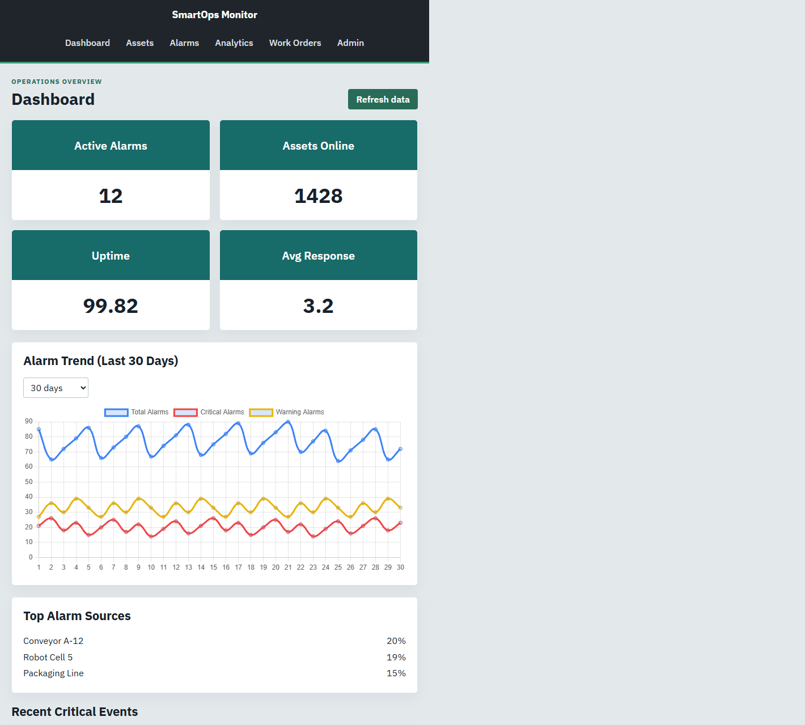
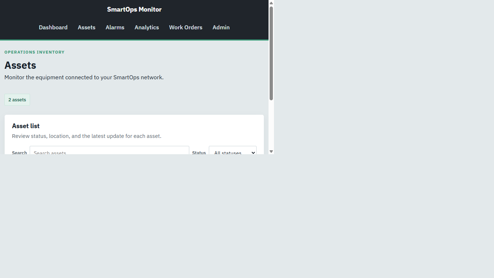

# SmartOps Monitor

[](https://github.com/corykochwork-alt/SmartOps/actions/workflows/build.yml)
[](https://angular.dev/)
[](https://www.typescriptlang.org/)

> A focused operations console for seeing asset health, alarm activity, and maintenance signals at a glance.

SmartOps Monitor is an Angular application for monitoring operational health across industrial assets. It brings alarms, asset status, analytics, notifications, and work-order workflows into one browser-based operations console.

## Product Preview

The dashboard is designed for a fast shift-level health check: KPI cards surface the current state, trend lines show alarm movement, and recent critical events keep the next action visible.

<p align="center">
	
</p>

<p align="center"><em>Dashboard overview with live in-memory development data</em></p>

<table>
	<tr>
		<td width="50%"></td>
		<td width="50%"><strong>Asset inventory</strong><br>Browse connected equipment, locations, status, and the latest update from one searchable view.</td>
	</tr>
</table>

## Application Areas

| Area | Purpose |
| --- | --- |
| Dashboard | Review current operational health and recent alarm activity. |
| Assets | Browse and monitor connected equipment with status filters. |
| Alarms | Investigate active and historical alarm conditions. |
| Analytics | Explore operational trends and performance data. |
| Work Orders | Track maintenance work and follow-up actions. |
| Notifications | Review operational notifications. |
| Admin | Manage administrative settings. |

## Project Structure

```text
src/app/
├── core/                 # Shared authentication and current-user state
├── features/             # Domain areas and their pages
│   └── dashboard/        # Dashboard page, components, models, API, and state
└── layout/               # Main layout, side navigation, top navigation, and footer
```

The dashboard feature is split into focused components for KPI cards, alarm trends, recent alarms, and top assets. Its models, service, and store keep display logic separate from the page shell.

## Getting Started

Install dependencies and start the development server:

```bash
npm install
npm start
```

Open `http://localhost:4200/` in a browser. Angular will rebuild and reload the application as source files change. The local experience uses seeded in-memory data, so it can be explored without a backend.

## Development Commands

| Command | Description |
| --- | --- |
| `npm start` | Start the local development server. |
| `npm run build` | Create a production build in `dist/`. |
| `npm test` | Run unit tests with Vitest. |
| `npm run watch` | Rebuild continuously using the development configuration. |

## Tech Stack

- Angular 21 with standalone components and Angular Router
- TypeScript
- Chart.js with `ng2-charts`
- RxJS
- Vitest and JSDOM for unit testing

## Project Status

This repository is an actively evolving operations-monitoring prototype. The dashboard and asset inventory are wired with local data and feature-level tests; additional workflow pages are being built out behind the same navigation shell.
